# Alerta Clima

> Protótipo acadêmico Android (Kotlin + Jetpack Compose) desenvolvido para o desafio **CitizenTech: tecnologia que melhora a vida das pessoas** — disciplina Android Kotlin Developer, Global Solution 2026.2.

## Integrantes

| Nome completo | RM |
| Henry Titotto | 55421 |
| Marcus Vinicius Martinho Lucas | 554616 |

---

## 1. Sobre o aplicativo

**Nome:** Alerta Clima

**Objetivo:** permitir que moradores de uma comunidade registrem e acompanhem ocorrências de eventos climáticos extremos (alagamento, deslizamento, calor extremo, queimada e vendaval) e consultem orientações práticas de segurança para cada tipo de ocorrência.

### Problema real

Eventos climáticos extremos estão cada vez mais frequentes nas cidades brasileiras. Quem mora em áreas de risco costuma ser o primeiro a perceber o problema (uma rua alagando, uma encosta com rachaduras), mas essa informação local raramente circula de forma organizada, e muitas pessoas não sabem como agir naquele momento. O resultado são decisões tardias e maior exposição a riscos.

### Público beneficiado

Moradores de bairros sujeitos a alagamentos, deslizamentos, calor extremo, queimadas e vendavais, com atenção especial a quem tem menos acesso a informação: famílias em áreas de risco, idosos, crianças e pessoas com mobilidade reduzida.

### Proposta de solução

O cidadão registra no app a ocorrência que observou (título, local, tipo, gravidade e descrição), acompanha se ela continua **ativa** ou já foi **resolvida** e recebe, em cada alerta ativo, uma **orientação de segurança** adequada ao tipo de evento. Tudo é salvo localmente no aparelho com Room.

> **Escopo do protótipo:** o app é um protótipo acadêmico. Os dados ficam apenas no aparelho e **não há integração** com a Defesa Civil, serviços meteorológicos ou qualquer serviço público/externo.

### Relação com o CitizenTech

A solução usa tecnologia para melhorar o cotidiano de cidadãos em situação de risco, ao dar visibilidade a problemas locais e orientar a ação, o que contribui diretamente para a prevenção de desastres e para a participação cidadã.

---

## 2. ODS relacionados

| ODS | Nome |
| **ODS 11** | Cidades e Comunidades Sustentáveis |
| **ODS 13** | Ação Contra a Mudança Global do Clima |

**Justificativa:**

- **ODS 11:** o app apoia a construção de comunidades mais seguras e resilientes ao dar visibilidade às ocorrências de risco no bairro e orientar a população, o que se relaciona com a meta de reduzir os impactos de desastres sobre as pessoas, com foco em quem está em situação de vulnerabilidade.
- **ODS 13:** o app trata de eventos associados a riscos climáticos (chuvas intensas, calor extremo, queimadas, vendavais) e promove educação e conscientização sobre como reagir a eles, fortalecendo a capacidade de adaptação das comunidades.

---

## 3. Funcionalidades

- **Tela inicial** com identidade visual, descrição do problema, resumo de alertas ativos/resolvidos (lido do banco) e acesso às funcionalidades.
- **Cadastro** de alertas: título, local, tipo de ocorrência, gravidade e descrição.
- **Listagem** dos alertas em cartões, com estado vazio quando não há registros.
- **Edição** de um alerta existente.
- **Alteração de status** (Ativo ⇄ Resolvido).
- **Exclusão** com confirmação (AlertDialog).
- **Orientação de segurança** exibida nos alertas ativos, conforme o tipo.
- **Validação** de campos obrigatórios (título e local): o registro inválido não é salvo.
- **Mensagens** de sucesso por Snackbar (registrado, atualizado, resolvido, reaberto, excluído).
- **Persistência local** com Room: os dados continuam após fechar e abrir o app.

## 4. Tecnologias utilizadas

| Tecnologia | Uso |
| --- | --- |
| Kotlin 2.0.21 | Linguagem |
| Jetpack Compose (BOM 2024.12.01) | Interface declarativa |
| Material 3 | Componentes e tema |
| Navigation Compose 2.8.5 | Navegação entre telas |
| ViewModel + StateFlow (Lifecycle 2.8.7) | Estado e lógica de apresentação |
| Room 2.6.1 (com KSP) | Persistência local (SQLite) |
| Gradle 8.9 / AGP 8.7.3 | Build |

## 5. Arquitetura e organização

```
app/src/main/java/com/example/alertaclima/
├── MainActivity.kt              # ponto de entrada; cria o ViewModel e chama a navegação
├── model/                       # AlertEntity (tabela) e enums (tipo, gravidade, status)
├── database/                    # AlertDao, AlertDatabase (Room) e Converters
├── repository/                  # AlertRepository (intermediário entre ViewModel e Room)
├── viewmodel/                   # AlertViewModel e classes de estado (UiState)
└── ui/
    ├── navigation/              # AppNavigation (NavHost e rotas)
    ├── screens/                 # HomeScreen, AlertListScreen, AlertFormScreen
    ├── components/              # AlertCard e LabelPill
    └── theme/                   # cores e tema Material 3
```

Fluxo de dados: **UI → ViewModel → Repository → DAO/Room** e, no sentido contrário, **Room (Flow) → Repository → ViewModel (StateFlow) → UI**.

### Persistência com Room

- `AlertEntity` define a tabela `alerts` com os campos `id`, `title`, `location`, `description`, `type`, `severity`, `status` e `createdAt`.
- `AlertDao` possui `observeAll()` (retorna `Flow<List<AlertEntity>>`), `insert`, `update` e `delete`.
- `AlertDatabase` cria o banco `alerta_clima.db` no armazenamento interno do app; `Converters` grava os enums como texto.
- Como o banco é um arquivo no aparelho, os registros **permanecem** depois de fechar e reabrir o app. Nenhum dado fica apenas em memória.
- A consulta retorna um `Flow`: toda alteração na tabela gera uma nova lista automaticamente.

### Uso do ViewModel

- `AlertViewModel` é único e compartilhado entre as telas (criado em `MainActivity`).
- `uiState: StateFlow<AlertListUiState>` transforma o `Flow` do Room em estado de tela (lista, carregamento, contadores). A UI usa `collectAsStateWithLifecycle()` e recompõe sozinha quando o banco muda (criar, editar, excluir, mudar status).
- `formState: StateFlow<AlertFormState>` guarda os campos do formulário, os erros de validação e se é edição; sobrevive à rotação da tela.
- `saveAlert()` faz a **validação**: se título ou local estiverem vazios, preenche as mensagens de erro e **não grava**. Se estiver válido, chama `insert` ou `update` conforme o caso.
- `toggleStatus()` e `deleteAlert()` executam as ações adicionais sobre os registros.
- Mensagens de sucesso são enviadas por um `Channel` e exibidas em `Snackbar` na listagem.

## 6. Como executar o projeto

**Requisitos:** Android Studio (versão recente, com suporte ao AGP 8.7.x), JDK 17 (já incluso no Android Studio) e Android SDK 35 instalado (o Android Studio oferece baixar automaticamente). Internet na primeira sincronização do Gradle.

1. Extraia o `.zip` do projeto.
2. No Android Studio: **File ▸ Open** e selecione a pasta `AlertaClima`.
3. Aguarde o **Gradle Sync** terminar (se o Android Studio sugerir atualizar o plugin do Android Gradle, pode recusar).
4. Crie ou selecione um emulador (API 24 ou superior) ou conecte um aparelho com depuração USB.
5. Clique em **Run ▸ Run 'app'**.

## 7. Como testar as funcionalidades

1. Abra o app: a **tela inicial** é exibida com os contadores zerados.
2. Toque em **Ver alertas da comunidade**: a listagem exibe o **estado vazio**.
3. Toque em **Novo alerta** e toque em **Salvar alerta** sem preencher nada: aparecem as mensagens de validação e nada é salvo.
4. Preencha título e local, escolha tipo e gravidade e salve: o app volta à listagem, mostra o novo cartão e uma mensagem de sucesso.
5. No cartão, toque em **Resolver**: o status muda para Resolvido (e a orientação some). Toque em **Reabrir** para voltar a Ativo.
6. Toque em **Editar**, altere um campo e salve: o cartão é atualizado.
7. Toque em **Excluir** e confirme no diálogo: o cartão desaparece.
8. Cadastre um alerta, **feche o app por completo** (remova dos apps recentes), abra novamente e confira que o registro continua na lista.
9. Volte para a tela inicial e confira que os contadores refletem os dados.

## 8. Fluxo principal

```
Tela inicial ──► Listagem de alertas ──► Formulário (novo / editar)
     │                  ▲                         │
     └──► Formulário ───┴─────── salvar ──────────┘
                        │
        Resolver / Reabrir / Editar / Excluir (na própria listagem)
```

1. O usuário entra pela **Tela inicial** e vê o resumo.
2. Vai para a **Listagem** (ou direto ao **Formulário**).
3. Cadastra um alerta, e o app retorna à listagem com mensagem de sucesso.
4. Na listagem, altera o status, edita ou exclui.
5. Ao reabrir o app, os alertas continuam salvos.

---

## 9. Evidências (capturas de tela)

> **Preencha:** tire as capturas executando o app e salve em `docs/screenshots/` com os nomes abaixo. Depois, confirme que as imagens aparecem corretamente neste README. Não deixe campos vazios na entrega.

### 9.1 Tela inicial
Identidade visual, resumo e botões de acesso.

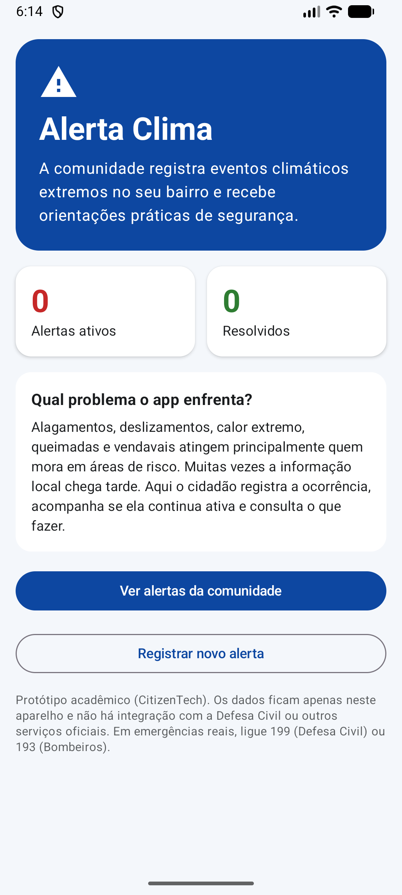

### 9.2 Listagem vazia
Estado sem dados.

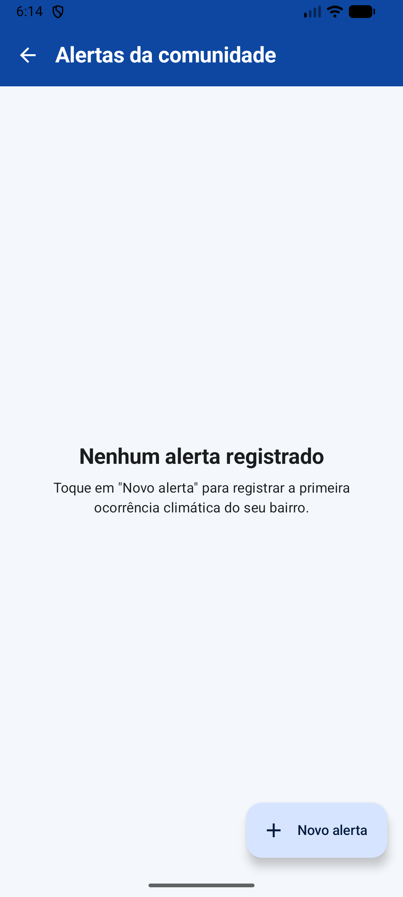

### 9.3 Formulário com validação
Mensagens de erro nos campos obrigatórios.

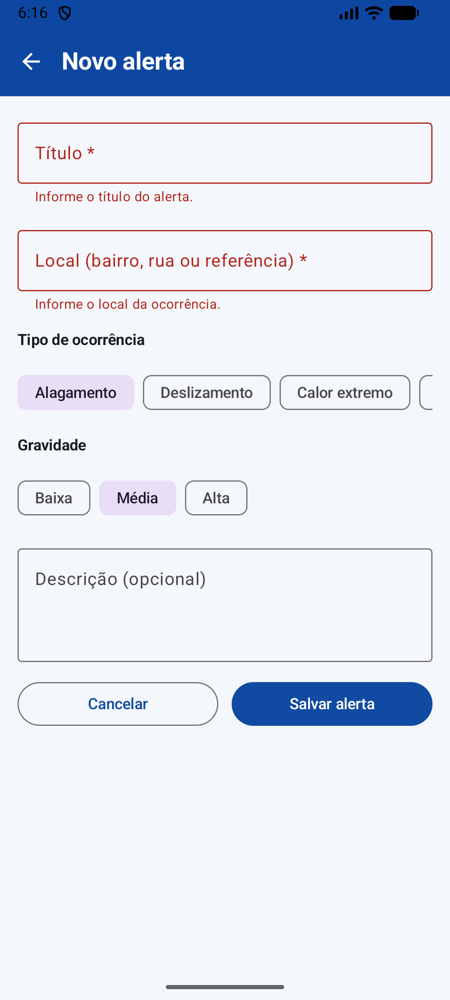

### 9.4 Criação de registro
Formulário preenchido.

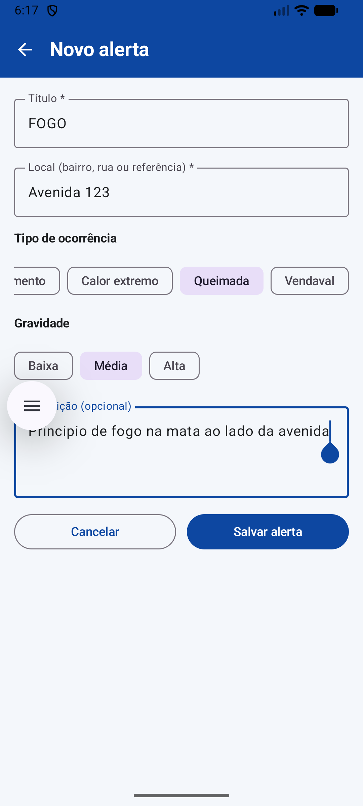

Listagem com o registro criado e mensagem de sucesso.

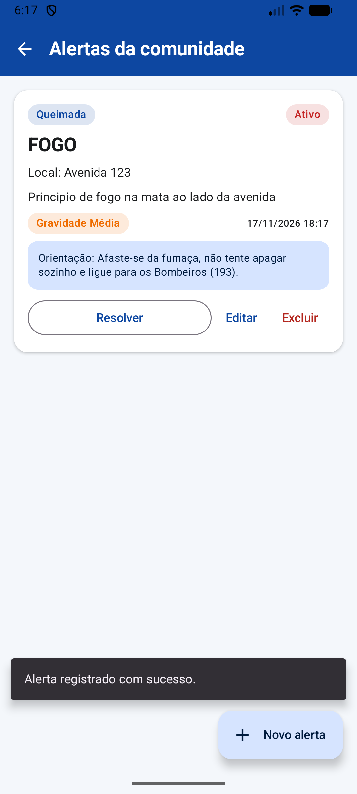

### 9.5 Ação adicional (alterar status / editar / excluir)
Registro após clicar em **Resolver**.

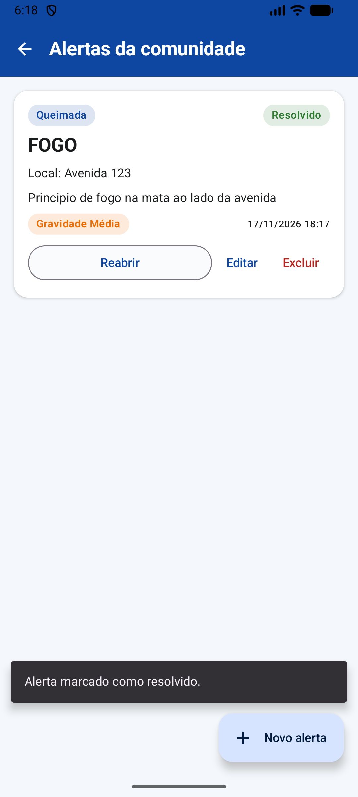

Edição de registro.

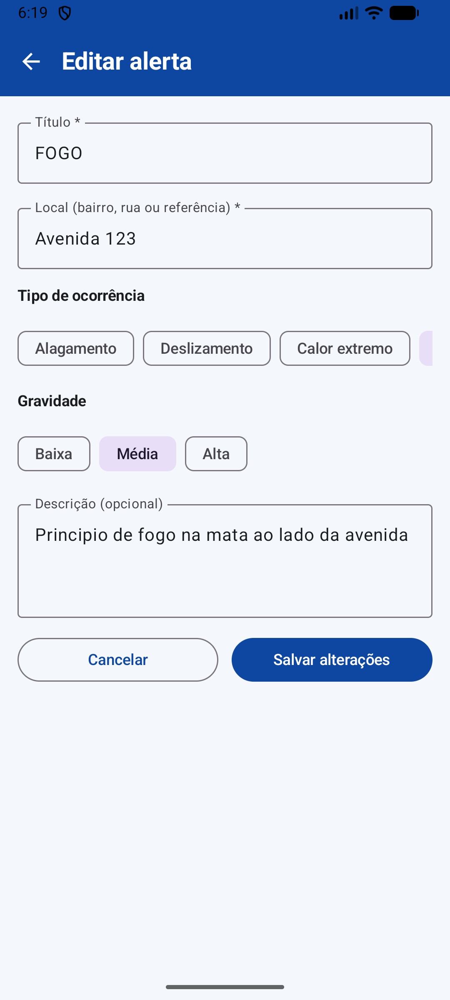

Confirmação de exclusão.

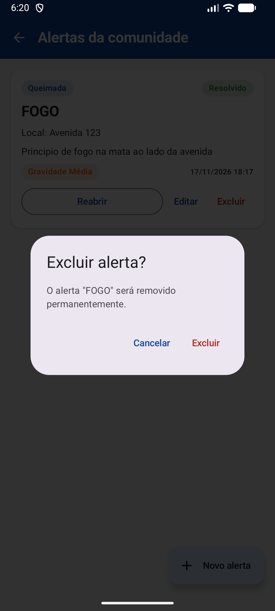

### 9.6 Persistência após reabrir o app
Antes de fechar o app (alerta cadastrado):


App encerrado (tela de apps recentes):

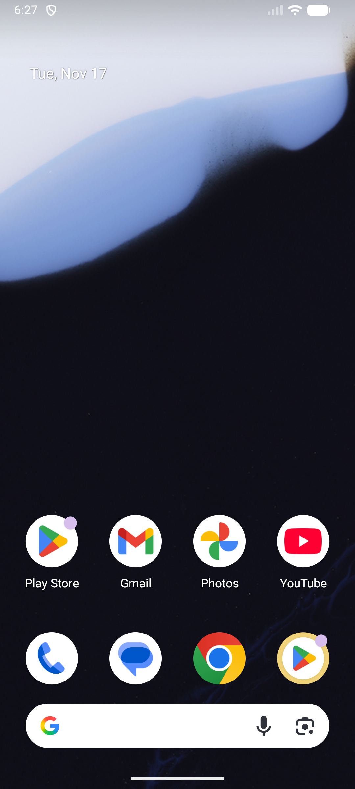

App reaberto: a tela inicial já mostra os contadores lidos do Room:

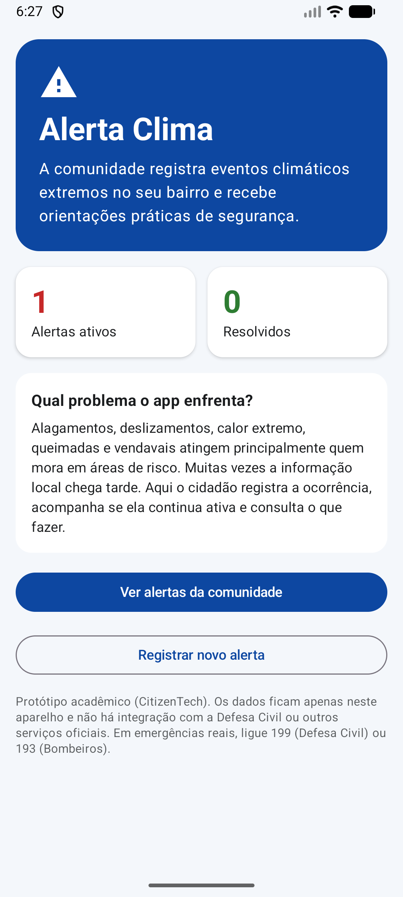

Listagem com o mesmo registro, criado em horário anterior ao da reabertura:

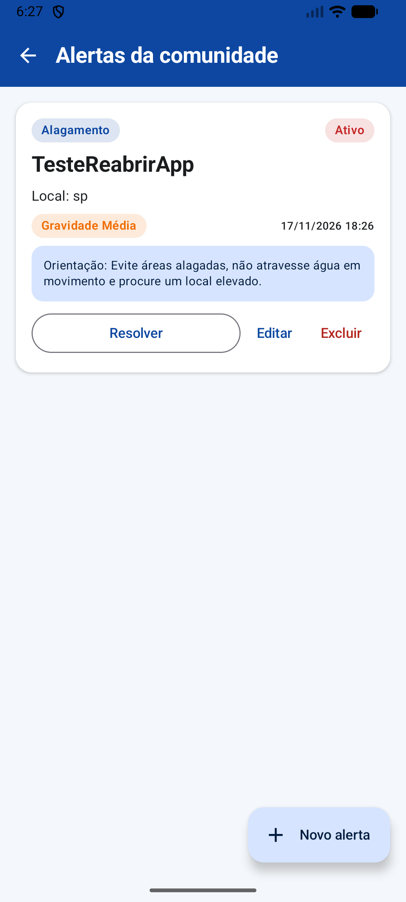

### Explicação breve do fluxo demonstrado

Primeiro, a listagem aparece vazia e o formulário bloqueia o cadastro quando título e local não são preenchidos, exibindo mensagens de erro. Em seguida, um alerta válido é cadastrado e aparece na listagem com uma mensagem de sucesso. Como ação adicional, o alerta é marcado como **Resolvido** (também é possível editar e excluir, com confirmação). Por fim, o app é encerrado e aberto novamente: a tela inicial mostra contadores maiores que zero e a listagem exibe o mesmo registro, com o status alterado e o horário de criação anterior. Isso comprova que os dados estão salvos no banco Room e não apenas na memória.